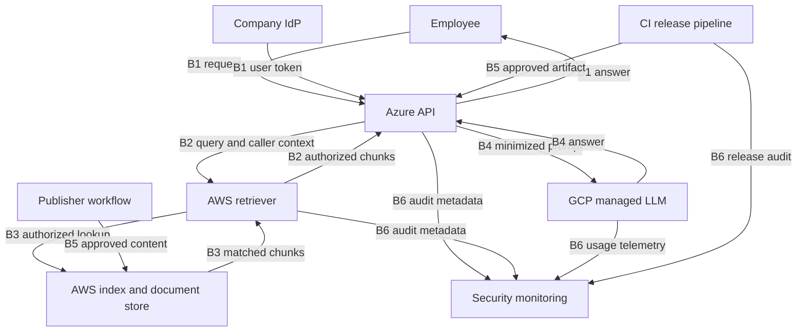

# Multi-Cloud GenAI Threat Model

Worked Phase 1 capstone · Mahesh Dommati · Fictional design

## Executive summary

The proposed assistant answers internal support questions using company documents across three cloud environments. It handles sensitive support records, so an access-control error can expose customer information. A compromised release could alter what the service runs or forwards.

The two highest baseline risks are replay of a workload credential and cross-team document disclosure, each scored 20 out of 25 in this training model. A build job with production authority follows at 15. These are scenario estimates based on explicit assumptions.

Before a pilot, the Data Platform and IAM teams should prove that users cannot retrieve other teams’ records and that unexpected workload identities are rejected. Before production, Release Engineering should show that a build job cannot deploy directly and that only an independently approved artifact can enter production. Security Operations and the platform teams should run a containment and recovery exercise, including a clean redeployment and index restore.

Request approval for a synthetic-data pilot once the pre-pilot evidence is recorded. Ask the service owner to review remaining valid-token replay, legitimate-access misuse and inaccurate model answers before expanding scope. Proposed controls and target scores require validation in the selected environment.

## Scope and assumptions

- Fictional internal support assistant. Azure hosts the API, AWS hosts retrieval and data, and GCP hosts managed inference. Provider-specific service selections, feature support, region and retention are design questions.
- The app retrieves authorized documents before invoking the model. The model has no direct data-store credentials and no write-capable tools. Identity, publishing, CI/CD and telemetry are separate flows.
- Employees, publishers, developers, release approvers, responders and workload identities are distinct actors. The baseline assumes the weaknesses in the register. Controls are proposed.
- In scope are request, document ingestion, release and audit flows. Employee endpoint internals, provider internals and model training are outside the review.
- Numbers use a training scale from 1 to 5. Baseline scores assume the listed weaknesses. Target scores are estimates conditional on control tests passing. They do not establish observed control effectiveness.

## Architecture and trust boundaries

| ID | Boundary | Crossing | Verification |
| --- | --- | --- | --- |
| B1 | Employee and identity provider → Azure API | User token and question | Verify identity and route permission |
| B2 | Azure API → AWS retrieval service | Scoped federated identity, query, verified user context | Validate federation and independent caller context |
| B3 | AWS retrieval service → index and object store | Authorized chunks and document metadata | Enforce document permissions and restrict service role |
| B4 | Azure API → GCP managed model | Minimized prompt and authorized chunks | Verify workload and model scope, approved data handling and retention |
| B5 | Publisher / CI release → data and production | Reviewed document versions and signed artifacts | Separate approval, build and deployment authority |
| B6 | Cloud workloads → security monitoring | Redacted audit and alert events | Restrict access and require attributable audit trails |

## Critical assets

| ID | Asset | Owner | CIA | Business impact |
| --- | --- | --- | --- | --- |
| A01 | Workload token | IAM | C/I | Service impersonation and unauthorized actions |
| A02 | LLM endpoint and quota | AI Platform | I/A | Service disruption and excess spend |
| A03 | Vector index and metadata | Data Platform | C/I/A | Sensitive retrieval or poisoned answers |
| A04 | CI/CD pipeline | Release Engineering | I/A | Unapproved production release |
| A05 | Support transcripts | Data Owner | C/I | Customer confidentiality breach |
| A06 | Source and infrastructure code | Engineering | C/I | Exposure of internals or unsafe changes |
| A07 | Model and prompt configuration | AI Platform | I/A | Incorrect or unsafe outputs |
| A08 | Audit trail | Security Operations | C/I/A | Sensitive log exposure or lost forensic evidence |
| A09 | Signing and encryption keys | Key Management | C/I/A | Forged releases or loss of data access |
| A10 | API workload | Application Platform | I/A | Unauthorized changes or downtime |
| A11 | User sessions | IAM | C/I | Account impersonation |
| A12 | Verified backups | Data Platform | C/I/A | Failure to recover trusted content |

## Threat register

Each score is likelihood × impact. Read target scores as conditional estimates after validation.

| ID | STRIDE | Boundary | Asset | Weakness | Scenario | Baseline | Target | Control |
| --- | --- | --- | --- | --- | --- | --- | --- | --- |
| T1 | Spoofing | B2 | A01 | Replayable workload credential and broad trust | Attacker impersonates API across clouds | 4 × 5 = 20 | 2 × 5 = 10 | C1 |
| T2 | Tampering | B5 | A03 | Ingestion accepts unreviewed content | Malicious text poisons retrieved context | 3 × 4 = 12 | 2 × 4 = 8 | C4 |
| T3 | Repudiation | B6 | A08 | Publisher or deploy event lacks actor attribution | Investigators cannot attribute changes | 3 × 4 = 12 | 1 × 4 = 4 | C7 |
| T4 | Information Disclosure | B3 | A05 | Retriever trusts query scope supplied by caller | User retrieves another team's transcript | 4 × 5 = 20 | 2 × 5 = 10 | C2 |
| T5 | Denial of Service | B4 | A02 | Inference quota is shared and unbounded per caller | Requests consume capacity and increase spend | 3 × 4 = 12 | 2 × 3 = 6 | C5 |
| T6 | Elevation of Privilege | B5 | A04 | Build identity can deploy directly | Compromised build gains production authority | 3 × 5 = 15 | 1 × 5 = 5 | C3 |

## Attack paths

### P1 · Workload credential replay

Related threats T1, T4

| From | To | Prerequisite | Proposed barrier |
| --- | --- | --- | --- |
| Exposed API | Code execution | Assume exploitable input-handling defect | C6 |
| Code execution | Stolen token | Runtime exposes reusable credentials | C1 |
| Stolen token | Retriever access | Federation accepts replayable token and broad subject | C1 |
| Retriever access | Transcript access | Retriever fails to enforce caller entitlement | C2 |
| Transcript access | Customer records are exposed | Retrieved text can leave through an API response | C2 |

### P2 · Compromised release

Related threats T6, T3

| From | To | Prerequisite | Proposed barrier |
| --- | --- | --- | --- |
| Exposed build workflow | Build execution | Build runs an untrusted dependency or change | C12 |
| Build execution | Deploy authority | Build identity can assume production release role | C3 |
| Deploy authority | Modified API workload | Admission accepts unapproved artifact | C3 |
| Modified API workload | Query interception | Release serves real traffic without a smoke-test gate | C13 |
| Query interception | Support data may be exposed | Malicious runtime can forward query content | C11 |

### P3 · Poisoned RAG content

Related threats T2

| From | To | Prerequisite | Proposed barrier |
| --- | --- | --- | --- |
| Publisher portal | Publisher session | Publisher account is phished | C14 |
| Publisher session | Content accepted | One account can approve and publish | C4 |
| Content accepted | Indexed instructions | Ingestion accepts unapproved document versions | C4 |
| Indexed instructions | Manipulated answer | Application passes chunks as context without safeguards | C15 |
| Manipulated answer | Support staff act on incorrect guidance | Workflow treats model text as an authoritative instruction | C15 |

## Control map

15 of 16 distinct controls come from layers outside network security.

| ID | Phase | Layer | Owner | Design | Evidence to collect |
| --- | --- | --- | --- | --- | --- |
| C1 | Prevent | Identity | IAM | Bind federated trust to issuer, subject and audience. Use scoped short-lived credentials and isolate credential access. | Unapproved issuer, subject and audience fail exchange; test replay within lifetime. |
| C2 | Prevent | Data | Data Platform | Enforce server-side per-document authorization using verified caller context and reject unauthorized content before inference. | Two-role cross-team test returns zero protected chunks. |
| C3 | Prevent | Pipeline | Release Engineering | Separate build and release identities. Require independent approval and verify trusted provenance at deploy. | Build identity cannot deploy. Unapproved digest is rejected. |
| C4 | Prevent | Data | Data Platform | Require independent approval of content and ingest only approved document versions. | Unapproved upload cannot be indexed. |
| C5 | Prevent | API | AI Platform | Apply per-user request size and usage caps with a bounded fallback. | Synthetic burst is capped and fallback stays usable. |
| C6 | Prevent | Application | App Team | Constrain inputs and patch exploitable API dependencies. | Regression input fails safely and deployed digest passes review. |
| C7 | Detect | Monitoring | Security Operations | Correlate actor, request ID, deployment digest and policy outcome. Alert on missing attribution or abnormal activity. | Synthetic unattributed change opens a routed alert with a trace ID. |
| C8 | Respond | Incident Response | Security Operations | Disable affected access, contain the workload, revoke sessions where supported and investigate using preserved evidence. | Tabletop measures isolation and tests whether issued credentials still work. |
| C9 | Recover | Data | Data Platform | Rebuild the index from a verified snapshot and recheck access rules before reopening. | Restore drill validates sample document hashes and cross-team denials. |
| C10 | Recover | Pipeline | Release Engineering | Redeploy a verified known-good image and verify release and query behavior. | Rollback drill proves expected digest and passes synthetic queries. |
| C11 | Prevent | Network | Cloud Platform | Deny unnecessary outbound destinations from the API runtime. | Approved endpoints work and an unapproved test destination fails. |
| C12 | Prevent | Pipeline | Release Engineering | Pin reviewed dependencies and isolate untrusted build jobs. | Untrusted job runs without publish or release credentials. |
| C13 | Prevent | Workload | App Team | Gate rollout with synthetic smoke tests before routing production traffic. | A deliberately failing smoke test blocks rollout. |
| C14 | Prevent | Identity | IAM | Require phishing-resistant authentication for publisher roles. | Publisher role denies a login using an unapproved authenticator. |
| C15 | Prevent | AI Application | AI Platform | Treat retrieved chunks as untrusted. Keep the model read-only and require human confirmation for sensitive actions based on answers. | Malicious sample cannot trigger a tool action; staff can inspect citations. |
| C16 | Detect | Monitoring | AI Platform | Alert on sustained quota pressure, bursts or elevated rejection rates. | Synthetic quota exercise routes an alert to the on-call owner. |

For P1, investigate token and retrieval anomalies using C7, contain access with C8 and verify a clean runtime with C10. For P2, correlate release evidence using C7, contain the release with C8 and redeploy using C10. For P3, correlate publishing events using C7, stop ingestion with C8 and restore trusted content with C9.

## Remediation priorities

| Priority | Gate | Threats | Controls | Owner | Exit evidence |
| --- | --- | --- | --- | --- | --- |
| 1 | Before pilot | T4 | C2 | Data Platform | Pass two-role retrieval tests for every protected namespace. |
| 2 | Before pilot | T1 | C1 | IAM | Reject unexpected federation claims and document the valid-token replay window. |
| 3 | Before production | T6 | C3 | Release Engineering | Demonstrate separation of duties and reject an unapproved artifact. |
| 4 | Before production | T2 / T3 / T5 | C4 / C7 / C5 / C16 | Data, Security Operations and AI Platform | Exercise publishing approval, alert routing and capped inference. |

## Residual risk and open validation

- A valid in-scope token may still be replayable during its lifetime. Verify compensating detection and containment with IAM.
- Authorized users may misuse information they can legitimately retrieve. Data ownership and monitoring remain necessary.
- Subtle poisoning can survive review and model output can still mislead. Test with synthetic adversarial documents and maintain human review.
- Provider disruption and shared regional capacity can still reduce availability. Validate fallback and restore objectives with the service owner.
